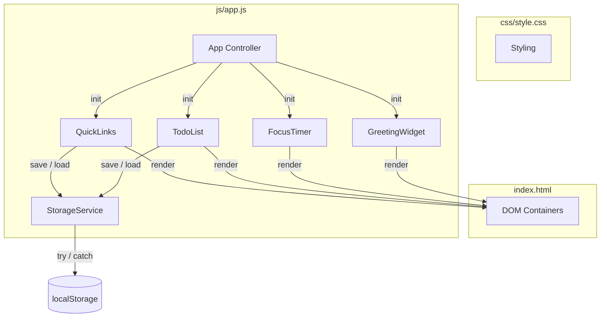
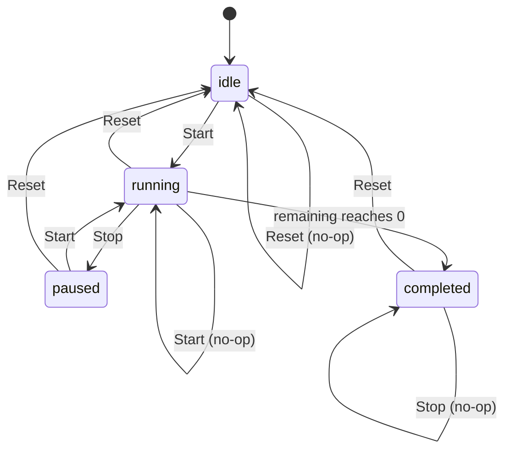

# Design Document

## Overview

The To-Do List Life Dashboard is a single-page, client-side web application built with plain HTML, CSS, and vanilla JavaScript. It provides four widgets on a single homepage-style interface: a time-based greeting, a 25-minute focus timer, a to-do list, and quick links to favorite websites. All user data (tasks and quick links) persists across sessions using the browser Local Storage API. The application has no backend server and uses no JavaScript frameworks or libraries.

This document describes the architecture, component design, data models, correctness properties, error handling, and testing strategy for the Dashboard.

### Design Goals

- **Simplicity**: A single HTML file, one CSS file, and one JavaScript file keep the project maintainable and readable.
- **Reliability**: Data persistence is robust against localStorage unavailability and quota limits, retaining session data in memory when storage fails.
- **Accuracy**: The focus timer anchors to wall-clock time to prevent drift from `setInterval` throttling in background tabs.
- **Accessibility**: Body text is at least 16px with a contrast ratio of at least 4.5:1.
- **Testability**: Pure logic functions are separated from DOM and I/O concerns to enable property-based testing of validation, formatting, and serialization.

### Scope and Constraints

The Dashboard is a standalone static site with no server-side component. It targets the two most recent major versions of Google Chrome, Mozilla Firefox, Microsoft Edge, and Apple Safari. The single JavaScript file (`js/app.js`) must organize all widget logic without external dependencies.

## Research Summary

### Timer Drift in JavaScript

`setInterval(fn, 1000)` does not fire exactly every 1000ms. It fires "at least 1000ms after the last call, when the event loop is free." Three compounding sources of error were identified: scheduling jitter, callback execution time, and background-tab throttling. Over a 25-minute session, drift can accumulate to several seconds if the countdown is implemented by decrementing a tick counter.

**Solution adopted**: Anchor the countdown to wall-clock time using `Date.now()`. Instead of counting ticks, compute remaining time as `endTime - Date.now()` on each tick. This prevents drift accumulation and self-corrects after background-tab throttling. Each tick is scheduled with `setTimeout` using `remaining % 1000 || 1000` to sync to whole-second boundaries. A `visibilitychange` listener forces an immediate re-render when the tab becomes visible again, since every tick calculates remaining time fresh.

Source: [JavaScript Countdown Timers: Why setInterval Drifts and How to Fix It](https://dev.to/work_hau_cb718f47075930f9/javascript-countdown-timers-why-setinterval-drifts-and-how-to-fix-it-26fe)

### localStorage Availability and Error Handling

Browsers can make localStorage unavailable in several ways: not exposing it on the global object, throwing a `SecurityError` on access in private/incognito mode, or throwing `QuotaExceededError` (DOMException code 22, or code 1014 / name `NS_ERROR_DOM_QUOTA_REACHED` in Firefox) when storage is full. Browsers throw slightly different `QuotaExceededError` variations across vendors, so both the `code` and `name` properties must be checked.

**Solution adopted**: Feature-detect localStorage availability once at startup by storing and removing a dummy item (`__storage_test__`). Separate `QuotaExceededError` detection from support/security errors by checking both `err.code` (22 or 1014) and `err.name` (`QuotaExceededError` or `NS_ERROR_DOM_QUOTA_REACHED`). After the availability check, `setItem` calls are wrapped in try-catch where only quota errors are expected.

Source: [Handling localStorage errors](https://mmazzarolo.com/blog/2022-06-25-local-storage-status), [MDN Web Storage API](https://developer.mozilla.org/en-US/docs/Web/API/Web_Storage_API/Using_the_Web_Storage_API)

## Architecture

### High-Level Architecture

The Dashboard follows a modular monolithic architecture within a single JavaScript file. A central **App Controller** initializes and wires together four widget modules and a shared **Storage Service**. Each widget module owns its DOM container, internal state, and event handlers. The Storage Service encapsulates all localStorage interactions, providing a consistent save/load interface with built-in error handling.



### File Structure

```
/
├── index.html          # Single HTML page with all widget containers
├── css/
│   └── style.css       # All styling (single CSS file)
└── js/
    └── app.js          # All application logic (single JS file)
```

### Module Organization

Since the project requires exactly one JavaScript file (Requirement 7), the code is organized into logical sections within `app.js` using an IIFE namespace pattern. Each module is a self-contained object with a clear interface:

- **StorageService**: localStorage feature detection, save/load with error handling, JSON serialization
- **GreetingWidget**: time/date display and greeting logic
- **FocusTimer**: 25-minute countdown state machine
- **TodoList**: task CRUD with validation and rendering
- **QuickLinks**: link CRUD with validation and rendering
- **App**: bootstrap, module initialization, data loading on page load

### Separation of Concerns

Pure logic functions are separated from DOM manipulation and I/O to maximize testability:

| Layer | Responsibility | PBT Suitable |
|-------|---------------|--------------|
| Pure logic | Greeting determination, time/date formatting, timer formatting, text/URL validation, serialization | Yes |
| State management | Timer state machine transitions, list operations (add/remove/toggle) | Yes (state transitions) |
| DOM rendering | Updating elements, event handling, rendering task/link rows | No |
| I/O | localStorage read/write, window.open | No |

### Design Decisions and Rationale

1. **Wall-clock anchored timer**: Chosen over tick-counting to prevent drift accumulation over the 25-minute session and to self-correct after background-tab throttling. This directly addresses the accuracy concern for a focus timer.

2. **localStorage feature detection upfront**: Detecting availability once at startup (rather than catching on every operation) cleanly separates "unsupported" from "full" scenarios. When unsupported, the app still runs with in-memory data and shows an error message.

3. **Pure function extraction**: Validation, formatting, and serialization are implemented as pure functions that take inputs and return outputs without side effects. This enables property-based testing without a DOM or localStorage environment.

4. **Event delegation**: Task and link lists use a single event listener on the container element rather than one listener per row. This keeps the DOM lightweight as lists grow and avoids re-binding listeners after every render.

5. **ID generation**: Uses `crypto.randomUUID()` when available, falling back to a timestamp-plus-random-string generator for older browsers. This ensures stable unique IDs across sessions.

## Components and Interfaces

### StorageService

Encapsulates all localStorage interactions with built-in error handling.

```
StorageService = {
  // Feature-detect localStorage availability once at startup.
  isAvailable(): boolean

  // Save the task list. Returns success status; on failure, retains
  // data in memory and returns an error message.
  saveTasks(tasks: Task[]): { success: boolean, error?: string }

  // Save the quick link list. Same contract as saveTasks.
  saveLinks(links: QuickLink[]): { success: boolean, error?: string }

  // Load tasks from localStorage. Returns an empty array if no data,
  // unavailable, or unparseable.
  loadTasks(): Task[]

  // Load quick links from localStorage. Same contract as loadTasks.
  loadLinks(): QuickLink[]
}
```

**Storage keys**: `'tdl-tasks'` maps to a JSON-encoded `Task[]`, `'tdl-links'` maps to a JSON-encoded `QuickLink[]`.

### GreetingWidget

Displays the current time, current date, and a time-based greeting. Updates every second.

```
GreetingWidget = {
  init(container: HTMLElement): void

  // --- Pure functions (exported for testing) ---

  // Maps a 24-hour value (0-23) to a greeting string.
  getGreeting(hour: number): string

  // Formats a Date into 12-hour time with seconds and AM/PM.
  // Example: "1:05:30 PM"
  formatTime(date: Date): string

  // Formats a Date into "Month Day, Year".
  // Example: "January 5, 2025"
  formatDate(date: Date): string
}
```

### FocusTimer

A 25-minute countdown with Start, Stop, and Reset controls, implemented as a wall-clock anchored state machine.

```
FocusTimer = {
  init(container: HTMLElement): void

  start(): void    // Begin or resume countdown
  stop(): void     // Pause countdown, retain remaining time
  reset(): void    // Restore to 25:00 and stop

  getState(): 'idle' | 'running' | 'paused' | 'completed'
  getRemainingMs(): number

  // --- Pure function (exported for testing) ---

  // Formats milliseconds remaining as zero-padded "MM:SS".
  // Example: 1499000 -> "24:59", 0 -> "00:00"
  formatTimer(remainingMs: number): string
}
```

**Timer state machine:**



Key behaviors derived from requirements:
- Start while already running is a no-op; the countdown continues without restarting (AC 2.7).
- Start when remaining is zero does not begin a new countdown (AC 2.8).
- Stop pauses and retains remaining duration (AC 2.4).
- Reset restores 25:00 and stops (AC 2.5).
- When remaining reaches zero, the countdown stops automatically (AC 2.6).

### TodoList

Manages tasks with add, edit, toggle-complete, and delete operations, persisting to localStorage on every change.

```
TodoList = {
  init(container: HTMLElement): void

  addTask(text: string): { success: boolean, error?: string }
  editTask(id: string, newText: string): { success: boolean, error?: string }
  toggleTask(id: string): void
  deleteTask(id: string): void
  getTasks(): Task[]

  // --- Pure functions (exported for testing) ---

  // Validates task text: rejects empty, whitespace-only, or >200 chars.
  validateTaskText(text: string): { valid: boolean, error?: string }

  // Serializes a Task[] to a JSON string.
  serializeTasks(tasks: Task[]): string

  // Deserializes a JSON string to a Task[].
  // Returns empty array on parse failure or invalid structure.
  deserializeTasks(json: string): Task[]
}
```

### QuickLinks

Manages website shortcut buttons with add, delete, and open operations, persisting to localStorage on every change.

```
QuickLinks = {
  init(container: HTMLElement): void

  addLink(name: string, url: string): { success: boolean, error?: string }
  deleteLink(id: string): void
  openLink(url: string): void   // window.open(url, '_blank')
  getLinks(): QuickLink[]

  // --- Pure functions (exported for testing) ---

  // Validates a link: rejects empty name, invalid URL scheme, or
  // duplicate URL. Empty-name error takes priority over duplicate-URL
  // error (AC 4.8).
  validateLink(name: string, url: string, existingUrls: string[]): {
    valid: boolean, error?: string
  }

  // Returns true when the link count has reached the 20-item maximum.
  isAtMaxLinks(links: QuickLink[]): boolean

  // Serializes a QuickLink[] to a JSON string.
  serializeLinks(links: QuickLink[]): string

  // Deserializes a JSON string to a QuickLink[].
  // Returns empty array on parse failure or invalid structure.
  deserializeLinks(json: string): QuickLink[]
}
```

### App

Bootstrap controller that initializes all modules and loads saved data on page load.

```
App = {
  init(): void
  // 1. Feature-detect localStorage via StorageService
  // 2. Load saved tasks and links; pass to TodoList and QuickLinks
  // 3. Initialize GreetingWidget, FocusTimer, TodoList, QuickLinks
  // 4. Wire up cross-module save callbacks
}
```

## Data Models

### Task

Represents a single to-do item.

```
interface Task {
  id: string        // unique identifier (crypto.randomUUID() or fallback)
  text: string      // 1-200 characters, not whitespace-only
  completed: boolean // completion status (false = incomplete, true = complete)
}
```

**Validation rules (AC 3.1, 3.6):**
- `text.trim().length === 0` → invalid (empty or whitespace-only)
- `text.length > 200` → invalid (exceeds maximum)
- Otherwise → valid

### QuickLink

Represents a single website shortcut.

```
interface QuickLink {
  id: string   // unique identifier (crypto.randomUUID() or fallback)
  name: string  // non-empty after trimming
  url: string   // begins with "http://" or "https://"
}
```

**Validation rules (AC 4.5, 4.6, 4.8):**
- `name.trim().length === 0` → invalid (field error, highest priority)
- `url` does not start with `http://` or `https://` → invalid (field error)
- `url` already exists in `existingUrls` → invalid (duplicate error)
- Empty-name error takes priority over duplicate-URL error (AC 4.8)
- Maximum 20 links (AC 4.7): when `links.length === 20`, the add control is disabled

### Serialized Storage Format

Tasks and links are stored as JSON strings under dedicated keys:

```
localStorage['tdl-tasks'] = '[{"id":"...","text":"...","completed":false}, ...]'
localStorage['tdl-links'] = '[{"id":"...","name":"...","url":"https://..."}, ...]'
```

On load, each key is read and parsed. If the key is missing, the value is empty, or parsing produces invalid data, an empty array is used (AC 5.4, 5.7).

## Correctness Properties

*A property is a characteristic or behavior that should hold true across all valid executions of a system—essentially, a formal statement about what the system should do. Properties serve as the bridge between human-readable specifications and machine-verifiable correctness guarantees.*

The following properties apply to the pure logic functions extracted from the Dashboard's widget modules. DOM rendering, localStorage I/O, and cross-browser behavior are covered by integration and smoke tests in the Testing Strategy section.

### Property 1: Time format includes AM or PM indicator

*For any* `Date` value, `formatTime(date)` SHALL produce a string in 12-hour format that includes either "AM" or "PM" and reflects the correct hour (1-12), minute (00-59), and second (00-59) derived from the input date.

**Validates: Requirements 1.1**

### Property 2: Date format includes full month name, numeric day, and four-digit year

*For any* `Date` value, `formatDate(date)` SHALL produce a string containing the full month name corresponding to the date's month, the numeric day corresponding to the date's day-of-month, and a four-digit year corresponding to the date's year.

**Validates: Requirements 1.2**

### Property 3: Greeting maps each hour to the correct time-of-day greeting

*For any* hour `h` in the range 0-23, `getGreeting(h)` SHALL return "Good morning" when `5 <= h <= 11`, "Good afternoon" when `12 <= h <= 17`, and "Good evening" when `18 <= h <= 23` or `0 <= h <= 4`.

**Validates: Requirements 1.3, 1.4, 1.5**

### Property 4: Timer display is zero-padded minutes and seconds

*For any* remaining duration in milliseconds in the range 0 to 1500000 (25 minutes), `formatTimer(remainingMs)` SHALL produce a string of exactly five characters matching the pattern `MM:SS` where minutes and seconds are each zero-padded to two digits.

**Validates: Requirements 2.2**

### Property 5: Start control transitions correctly from every timer state

*For any* FocusTimer state, activating the Start control SHALL transition the timer to "running" when the current state is "idle" or "paused", and SHALL be a no-op (no state change, no alteration of remaining duration) when the current state is "running" or "completed".

**Validates: Requirements 2.3, 2.7, 2.8**

### Property 6: Stop control pauses and preserves remaining duration

*For any* FocusTimer in the "running" state with remaining duration `d`, activating the Stop control SHALL transition the timer to "paused" and the remaining duration SHALL remain `d`.

**Validates: Requirements 2.4**

### Property 7: Reset control restores 25 minutes from any state

*For any* FocusTimer state, activating the Reset control SHALL transition the timer to "idle", set the remaining duration to 1500000 milliseconds (25 minutes), and stop the countdown.

**Validates: Requirements 2.5**

### Property 8: Countdown stops when remaining duration reaches zero

*For any* FocusTimer in the "running" state whose remaining duration reaches zero, the timer SHALL transition to the "completed" state and stop the countdown.

**Validates: Requirements 2.6**

### Property 9: Task text validation classifies valid and invalid text correctly

*For any* string `s`, `validateTaskText(s)` SHALL return valid if and only if `s.trim().length >= 1` and `s.length <= 200`, and SHALL return invalid with an error message for all other strings (empty, whitespace-only, or exceeding 200 characters).

**Validates: Requirements 3.1, 3.6**

### Property 10: Task completion toggle is an involution

*For any* Task with completion status `c`, toggling the completion status once SHALL produce the opposite of `c`, and toggling twice SHALL restore the original status `c`.

**Validates: Requirements 3.3**

### Property 11: Task deletion removes the task by id

*For any* task list containing a task with id `x`, deleting the task with id `x` SHALL remove that task from the list and reduce the list length by exactly one, leaving all other tasks unchanged.

**Validates: Requirements 3.4**

### Property 12: Task edit succeeds for valid text and retains original on invalid text

*For any* Task with text `t` and any replacement text `s`, editing SHALL succeed (replacing `t` with `s` while preserving the task's id and completion status) if and only if `s` is valid, and SHALL be rejected (retaining `t` unchanged) when `s` is invalid.

**Validates: Requirements 3.7, 3.8**

### Property 13: Quick link validation rejects invalid input with correct error priority

*For any* link name `n`, URL `u`, and set of existing URLs `E`, `validateLink(n, u, E)` SHALL return valid if and only if `n.trim()` is non-empty, `u` begins with `http://` or `https://`, and `u` is not in `E`. When the name is empty, the invalid-field error SHALL take priority over the duplicate-URL error.

**Validates: Requirements 4.3, 4.5, 4.6, 4.8**

### Property 14: Quick link deletion removes the link by id

*For any* link list containing a link with id `x`, deleting the link with id `x` SHALL remove that link from the list and reduce the list length by exactly one, leaving all other links unchanged.

**Validates: Requirements 4.4**

### Property 15: Serialization round-trip preserves all data

*For any* valid `Task[]` or `QuickLink[]`, serializing the array to JSON and then deserializing the result SHALL produce an equivalent array that preserves every element's id, text (or name), completion status (or url), and ordering without loss.

**Validates: Requirements 5.5**

### Property 16: Deserialization returns empty for missing or invalid data

*For any* localStorage key that is missing, empty, or contains a string that cannot be parsed as a valid `Task[]` or `QuickLink[]`, deserialization SHALL return an empty array rather than throwing or returning partial data.

**Validates: Requirements 5.4, 5.7**

## Error Handling

The Dashboard handles errors at three layers: input validation, storage failures, and corrupt persisted data.

### Input Validation Errors

**Invalid task text (AC 3.6, 3.8):** When the user submits task text that is empty, whitespace-only, or exceeds 200 characters, the To_Do_List rejects the submission, adds no task (or retains the original text on edit), and displays an error message: "Task text must be between 1 and 200 characters."

**Invalid quick link (AC 4.5, 4.6, 4.8):** When the user submits a quick link with an empty name or a URL not beginning with `http://` or `https://`, the Quick_Links component rejects the submission and displays an inline error indicating which field is invalid. When the URL duplicates an existing link's URL, it displays a duplicate-URL error. When both an empty name and a duplicate URL are present, the invalid-field error is shown with priority over the duplicate-URL error.

**Maximum links reached (AC 4.7):** When 20 quick links already exist, the add submission control is disabled and a message indicates the maximum has been reached.

### Storage Errors

**localStorage unavailable (AC 6.5):** The StorageService feature-detects localStorage at startup. If unavailable (not exposed, blocked in private mode, or access throws), the Dashboard displays an error message indicating data persistence has failed and retains all session data in memory. The app remains fully functional for the session but data will not persist across reloads.

**Quota exceeded on write (AC 5.6):** Each `setItem` call is wrapped in a try-catch. If a write fails with `QuotaExceededError` (checked across browser variants by code 22, code 1014, name `QuotaExceededError`, or name `NS_ERROR_DOM_QUOTA_REACHED`), the Dashboard retains the current data in the user interface and displays an error message indicating the save failed. The in-memory state is not affected by the failed write.

### Corrupt Persisted Data (AC 5.7)

On load, if localStorage contains data under a task or link key that cannot be parsed as valid JSON or does not conform to the expected `Task[]` or `QuickLink[]` structure, the deserialization function catches the error and returns an empty array. The Dashboard displays empty lists rather than crashing or showing partial corrupt data.

### Error Message Display

Error messages are displayed inline within the relevant widget (near the input form or button that triggered the error), not as modal dialogs, to avoid disrupting the calm, minimal aesthetic. Messages use the same font size and contrast standards as body text (at least 16px, contrast ratio at least 4.5:1).

## Testing Strategy

### Dual Testing Approach

The Dashboard uses both property-based tests and example-based/integration tests for comprehensive coverage:

- **Property-based tests** verify universal properties of pure logic functions (validation, formatting, serialization, state transitions) across a wide input space.
- **Unit tests** verify specific examples, edge cases, and integration points between components.
- **Integration tests** verify DOM rendering, localStorage I/O, and cross-component wiring.
- **Smoke tests** verify project structure, technology stack constraints, and one-time setup.

### Property-Based Testing

**Library:** [fast-check](https://fast-check.dev/) for JavaScript property-based testing.

**Test runner:** [Vitest](https://vitest.dev/) with the `jsdom` environment for DOM-related tests, and the default Node environment for pure logic tests.

**Configuration:**
- Each property test runs a minimum of 100 iterations with randomized inputs.
- Each property test is tagged with a comment referencing the design property it validates.
- Tag format: `// Feature: todo-life-dashboard, Property N: <property description>`

**Testable properties** are the 16 correctness properties defined above. Each property maps to a single property-based test:

| Property | Function Under Test | Input Generator |
|----------|-------------------|-----------------|
| 1 - Time format | `formatTime` | Arbitrary `Date` values across full time range |
| 2 - Date format | `formatDate` | Arbitrary `Date` values across full date range |
| 3 - Greeting mapping | `getGreeting` | Integers 0-23 |
| 4 - Timer format | `formatTimer` | Integers 0-1500000 (ms) |
| 5 - Start transitions | Timer state machine | State machine model with arbitrary state + start |
| 6 - Stop pauses | Timer state machine | Running timer with arbitrary remaining > 0 |
| 7 - Reset restores | Timer state machine | Arbitrary state + reset |
| 8 - Countdown at zero | Timer state machine | Running timer approaching zero |
| 9 - Task validation | `validateTaskText` | Arbitrary strings (empty, whitespace, short, long, boundary) |
| 10 - Toggle involution | toggle operation | Tasks with arbitrary completion status |
| 11 - Task delete | delete operation | Task lists with arbitrary tasks |
| 12 - Task edit | edit operation | Tasks + arbitrary replacement text |
| 13 - Link validation | `validateLink` | Names, URLs, existing URL sets |
| 14 - Link delete | delete operation | Link lists with arbitrary links |
| 15 - Round-trip | serialize/deserialize | Arbitrary `Task[]` and `QuickLink[]` |
| 16 - Deserialization errors | deserialize | Missing keys, empty strings, invalid JSON |

### Unit Tests

Unit tests cover specific examples and edge cases not fully exercised by property tests:

- Timer initialization at 25:00 (AC 2.1)
- Edit control makes task text editable (AC 3.2)
- Quick link max limit at exactly 20 (AC 4.7 edge case)
- Boundary values: task text at exactly 200 characters (valid) vs 201 (invalid)
- URL validation: `http://` accepted, `https://` accepted, `ftp://` rejected, `javascript:` rejected

### Integration Tests

Integration tests verify DOM rendering and I/O behavior using the jsdom environment and mocked localStorage:

- Greeting widget updates the DOM at one-second intervals (AC 1.1)
- Task list renders all tasks with text and completion status (AC 3.5)
- Quick links render as clickable buttons labeled with link name (AC 4.1)
- Opening a link calls `window.open` with the URL and `_blank` (AC 4.2)
- Saving tasks/links calls `StorageService.saveTasks`/`saveLinks` after each mutation (AC 5.1, 5.2)
- Loading the dashboard populates widgets from localStorage (AC 5.3)
- Quota exceeded: mocked `setItem` throws, verify in-memory data retained and error shown (AC 5.6)
- localStorage unavailable: feature detection fails, verify error shown and data in memory (AC 6.5)

### Smoke Tests

Smoke tests verify structural and constraint requirements:

- Exactly one CSS file at `css/style.css` (AC 7.1)
- Exactly one JavaScript file at `js/app.js` (AC 7.2)
- No JavaScript frameworks or libraries imported (AC 6.2)
- No backend server or network calls required (AC 6.3)
- localStorage is the sole persistence mechanism, no fetch/XHR (AC 6.4)
- Body text computed font-size is at least 16px (AC 9.4)
- Text-to-background contrast ratio is at least 4.5:1 (AC 9.4)

### Cross-Browser and Performance Testing

Cross-browser compatibility (AC 8.1, 8.2) and performance requirements (AC 9.1, 9.2) are verified through manual or automated testing in the target browsers (Chrome, Firefox, Edge, Safari). These are not automated in the CI property/unit test suite due to their dependence on real browser environments and timing measurements.

### Test File Organization

```
tests/
├── unit/
│   ├── greeting.test.js        # Properties 1-3, greeting unit tests
│   ├── timer.test.js            # Properties 4-8, timer unit tests
│   ├── todo.test.js             # Properties 9-12, task unit tests
│   ├── quicklinks.test.js       # Properties 13-14, link unit tests
│   └── storage.test.js           # Properties 15-16, serialization tests
├── integration/
│   ├── dom.test.js              # DOM rendering and interaction tests
│   └── storage-io.test.js       # localStorage I/O with mocks
└── smoke/
    └── structure.test.js        # File structure and constraint tests
```
